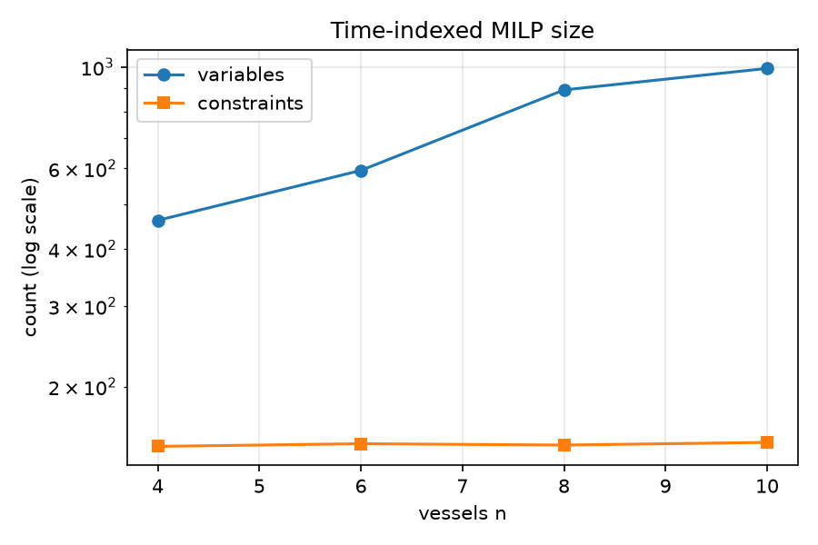
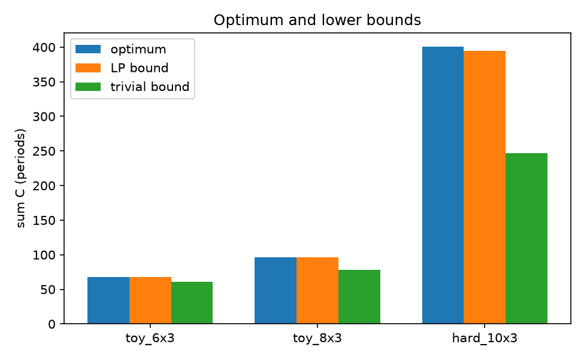

# 实验一：MILP、LP 与调度基本模型

> 本报告的全部数值来自 `experiments/run_experiments.py` 的一次运行，原始记录在
> `experiments/data/e1_*.csv`，图在 `experiments/figures/`。运行命令见文末。

## 1. 实验目的

1. 理解泊位分配问题（BAP）如何写成 **0-1 整数线性规划**，以及时间索引与析取两种建模方式的差别。
2. 用**不依赖求解器的穷举**为小实例算出标准答案，检验两个 MILP 是否给出同一个最优值。
3. 观察 **LP 松弛下界**与整数最优的差距，理解"下界"在差距（gap）计算中的作用。
4. 观察模型规模随船数如何增长，以及 **目标函数（sum_C 与 C_max）**如何改变最优调度。
5. 观察业务约束（潮汐窗、岸桥上限）对最优值的影响。

## 2. 实验环境与设置

- Python 3.12，PuLP 4.0，HiGHS 1.15.1；`dt = 0.5 h`，目标默认 `sum_C = Σ C_i`（总完成时间，单位：周期）。
- 实例：`make_toy_instance`（紧凑实例，`tight=True`，3 个泊位，horizon 48）与
  `make_hard_instance`（带潮汐窗与岸桥上限，slack 控制 horizon 松紧）。
- 所有实例由固定 seed 生成；求解时间上限 30–60 s，`mip_gap = 0`。
- "已证明最优"指求解器返回 `Optimal`；若返回时间/节点上限，该值只是上界，不作为参照。

## 3. 实验算法列表

| 名称 | 类型 | 一句话说明 |
|---|---|---|
| 时间索引 MILP（TI） | 精确 | 为每个（船、泊位、开始周期）设一个 0-1 变量，容量约束化为"每泊位每周期至多一船" |
| 析取 MILP（DJ） | 精确 | 不用时间网格，用成对先后变量 + big-M 表示同一泊位上的顺序 |
| LP 松弛 | 下界 | 把 0-1 变量放宽到 [0,1]，最优值一定不高于整数最优 |
| 平凡下界 | 下界 | 每艘船最早完成时间（到港 + 作业）之和 |
| 穷举枚举 | 标准答案 | 无求解器：枚举泊位分配 + 回溯搜索开始时刻，小实例上精确 |
| 目标 sum_C | 目标函数 | 所有船完成时间之和，越小越好 |
| 目标 C_max | 目标函数 | 最后一艘船的完成时间（makespan） |

## 4. 实验记录

### 4.1 模型规模与求解（TI，3 泊位，horizon 48）

| n（船数） | 目标值 | 变量数 | 约束数 | 求解时间 (s) | 是否证明最优 |
|---|---|---|---|---|---|
| 4 | 42 | 462 | 148 | 0.052 | 是 |
| 6 | 100 | 594 | 150 | 0.063 | 是 |
| 8 | 113 | 891 | 149 | 0.142 | 是 |
| 10 | 209 | 993 | 151 | 0.097 | 是 |

原始数据：`data/e1_scale.csv`。

### 4.2 两种公式一致性与穷举对拍

| n | TI 目标 | DJ 目标 | 一致 | TI 时间 (s) | DJ 时间 (s) | 穷举目标 | 穷举扩展数 | 一致 |
|---|---|---|---|---|---|---|---|---|
| 4 | 43 | 43 | 是 | 0.042 | 0.014 | 43 | 50,142 | 是 |
| 5 | 54 | 54 | 是 | 0.055 | 0.167 | 54 | 736,088 | 是 |
| 6 | 68 | 68 | 是 | 0.064 | 0.233 | 未运行（规模超出本实验预算） | — | — |

原始数据：`data/e1_formulations.csv`、`data/e1_enumeration.csv`。

### 4.3 下界与整数最优

| 实例 | 最优值 | 平凡下界 | 平凡下界差 (%) | LP 下界 | LP 下界差 (%) |
|---|---|---|---|---|---|
| toy_6x3 | 68 | 61 | 10.29 | 68.0 | 0.00 |
| toy_8x3 | 96 | 78 | 18.75 | 96.0 | 0.00 |
| hard_10x3 | 401 | 247 | 38.40 | 394.33 | 1.66 |

"下界差" =（最优值 − 下界）/ 最优值 × 100%，衡量下界离最优有多远。

### 4.4 目标函数对调度的影响（7 船，3 泊位）

| 优化的目标 | 该目标最优值 | 同一调度在另一目标下的值 |
|---|---|---|
| sum_C | 114 | C_max = 24 |
| C_max | 22 | sum_C = 121 |

### 4.5 业务约束的影响（8 船，3 泊位，horizon 76）

| 约束配置 | 最优值 | 相对无约束 |
|---|---|---|
| 无约束 | 221 | — |
| 仅潮汐窗 | 309 | +39.8% |
| 仅岸桥上限 | 251 | +13.6% |
| 潮汐 + 岸桥 | 309 | +39.8% |

原始数据：`data/e1_objectives.csv`、`data/e1_constraints.csv`。

## 5. 实验结果与分析



**（1）规模不是简单的 O(n·m·T)。** 课本上时间索引模型的变量数是船数 × 泊位数 × 周期数，
但实现只为"该船在该泊位上的可行开始周期"建变量（要避开潮汐窗、满足到港与 horizon），
容量行也只为非空集合添加。因此实测变量数从 462 增长到 993，约束数几乎不变（148→151），
求解都在 0.15 s 内。理论复杂度是上界，实际规模由实例的可行域决定——这一点直接影响"模型能算多大"。

**（2）三种方法给出同一个数，才是可信的最优值。** 两种公式（时间索引、析取）在 n=4/5/6 上
目标值完全一致；n=4/5 上无求解器穷举也得到同一个值（分别扩展 5 万、73 万次）。
这就是本项目的核心方法论：不是相信求解器的自称，而是让互不相关的实现互相印证。



**（3）LP 下界比平凡下界强得多，但松紧依实例而定。** 两个 toy 实例上 LP 松弛恰好等于整数最优
（差 0%），而在 10 船的 hard 实例上 LP 下界为 394.33、最优为 401，差 1.66%；平凡下界则差 10%–38%。
这说明：LP 是有效且通常更强的下界，但不能假设它总是紧的。当求解器没证完最优时，报告里的 gap
只能拿这种**有效下界**做分母，并注明参照类型——否则会系统性美化启发式。

**（4）目标函数决定调度，不能混用。** 以 sum_C 最优的调度（114）其 C_max 是 24；以 C_max 最优的
调度（22）其 sum_C 是 121，比 sum_C 最优差 6.1%。两个目标都是"合理"的，但选哪个会改变最优解；
比较不同方法时必须用同一个目标，否则数字不可比。

**（5）约束是否"起作用"要看实例。** 潮汐窗把最优值从 221 推到 309（+39.8%），岸桥上限单独只到 251
（+13.6%）；两者同时开启仍是 309——说明该实例上潮汐已经把船在时间上摊开，岸桥不再构成额外瓶颈。
这解释了为什么"加了很多约束"不等于"问题变难"：难的是 horizon 相对作业量的松紧（slack），
不是约束的数量。

## 6. 小结

- 时间索引与析取两种 MILP 以及无求解器穷举在可算实例上完全一致，模型可信。
- 模型的实测规模由可行开始域决定，远小于理论 O(n·m·T)，小实例可在 0.1 s 内证明最优。
- LP 松弛是有效下界，toy 实例上恰好紧、hard 实例上差 1.66%；平凡下界差 10%–38%。
- sum_C 与 C_max 给出不同的最优调度（114/24 对 121/22），目标必须统一。
- 潮汐窗的影响（+39.8%）远大于岸桥上限（+13.6%），且两者叠加并不累加，说明约束是否绑定依实例而定。

## 7. 复现

```powershell
.venv\Scripts\python.exe experiments\run_experiments.py
```

输出：`experiments/data/e1_*.csv`，图 1–2 在 `experiments/figures/`。
