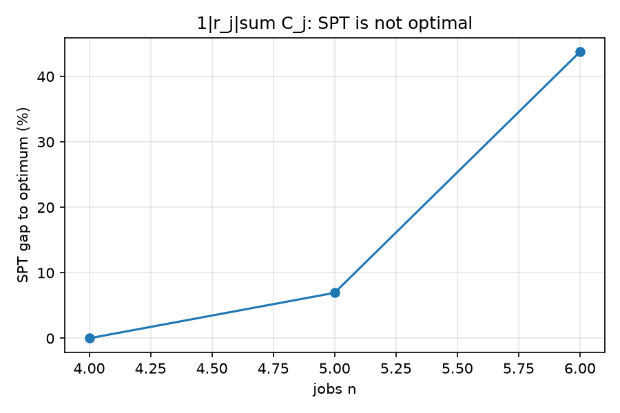

# 实验二：经典调度问题与建模

> 数据来自 `experiments/run_experiments.py`，原始记录在 `experiments/data/e2_*.csv`。

## 1. 实验目的

1. 建立**泊位分配问题（BAP）与经典调度问题**的对应：泊位 ↔ 机器、船 ↔ 工件、到港时间 ↔ 释放时间、
   潮汐窗 ↔ 机器不可用区间。
2. 在只有 4–7 个工件的小规模上，用**全排列穷举**验证几条经典规则（SPT、WSPT）什么时候最优、
   什么时候失效。
3. 用穷举验证并行机、流水车间、作业车间的 MILP 建模是否正确。
4. 观察**作业车间精确分支定界**与 MILP 的一致性，并解释 BAP 与经典模型的差异（整泊位独占、船长约束）。

## 2. 实验环境与设置

- Python 3.12，PuLP 4.0，HiGHS 1.15.1。
- 经典模型的数据由 `make_simple_problem` 生成：加工时间 `p_j ~ U[2,8]`，权重 `w_j ~ U[1,3]`；
  带释放时间的变体 `r_j ~ U[0,12]`；horizon 取足够大以免截断。
- 单机穷举限制 n ≤ 8（n! 种排列）；并行机穷举按"分配 × 每机顺序"枚举，上限 40 万次；
  流水车间对 n=4/5 全排列（24/120 种）；作业车间用 Giffler–Thompson 精确分支定界。
- 所有时间单位为加工周期。

## 3. 实验算法列表

| 名称 | 类型 | 一句话说明 |
|---|---|---|
| SPT | 规则 | 加工时间短的先做；对 `1||ΣC_j` 可证明最优 |
| WSPT | 规则 | 按 `p_j / w_j` 升序；对 `1||Σw_jC_j` 可证明最优 |
| 单机全排列 | 标准答案 | 枚举所有顺序，带释放时间时按"尽早开工"排 |
| 并行机 MILP | 精确 | 时间索引模型：`x[j,k,t]`，每机每期至多一个工件 |
| 并行机穷举 | 标准答案 | 枚举"工件→机器"分配 + 每台机器上的顺序 |
| 流水车间 MILP | 精确 | 所有工件按同一机器顺序加工，成对排序变量 |
| 流水车间全排列 | 标准答案 | 枚举所有工件顺序，按机器逐台推 makespan |
| 作业车间 MILP | 精确 | 每个工件有固定机器路线，操作两两析取 |
| 作业车间 B&B | 精确 | Giffler–Thompson 冲突集分支，覆盖全部 active 调度 |
| 目标 | — | 单机/并行机用 `ΣC_j`（加权时 `Σw_jC_j`），车间用 `C_max` |

## 4. 实验记录

### 4.1 单机、无释放时间（验证 SPT / WSPT 的最优性）

| n | SPT 的 ΣC | 穷举 ΣC | SPT 最优 | WSPT 的 ΣwC | 穷举 ΣwC | WSPT 最优 |
|---|---|---|---|---|---|---|
| 4 | 48 | 48 | 是 | 82 | 82 | 是 |
| 5 | 58 | 58 | 是 | 86 | 86 | 是 |
| 6 | 87 | 87 | 是 | 141 | 141 | 是 |
| 7 | 125 | 125 | 是 | 190 | 190 | 是 |

原始数据：`data/e2_single.csv`。

### 4.2 单机、带释放时间（`1|r_j|ΣC_j`）

| n | SPT 的 ΣC | 穷举 ΣC | SPT 差距 (%) | SPT 最优 | WSPT 的 ΣwC | 穷举 ΣwC | WSPT 差距 (%) |
|---|---|---|---|---|---|---|---|
| 4 | 40 | 40 | 0.00 | 是 | 112 | 89 | 25.84 |
| 5 | 77 | 72 | 6.94 | 否 | 159 | 119 | 33.61 |
| 6 | 115 | 80 | 43.75 | 否 | 191 | 159 | 20.13 |

原始数据：`data/e2_release.csv`。

### 4.3 并行机（n=5，m=3，`P|r_j, M_j|ΣC_j`）

| 变体 | MILP | 穷举 | 一致 | MILP 时间 (s) |
|---|---|---|---|---|
| 仅加工时间 | 15 | 15 | 是 | 0.102 |
| 加释放时间 | 33 | 33 | 是 | 0.107 |
| 加机器不可用 | 19 | 19 | 是 | 0.055 |
| 释放 + 不可用 | 36 | 36 | 是 | 0.047 |

### 4.4 置换流水车间（`F|prmu|C_max`）

| n × m | MILP | 全排列 | 一致 | 排列数 | MILP 时间 (s) |
|---|---|---|---|---|---|
| 4 × 3 | 25 | 25 | 是 | 24 | 0.026 |
| 5 × 3 | 34 | 34 | 是 | 120 | 0.042 |

### 4.5 作业车间（`J||C_max`）与一个特殊实例

| 实例 | MILP | 精确 B&B | 一致 | B&B 节点数 | B&B 时间 (s) |
|---|---|---|---|---|---|
| 4 × 3 | 30 | 30 | 是 | 421 | 0.0008 |
| 5 × 3 | 42 | 42 | 是 | 2,460 | 0.0049 |
| 4 × 4 | 37 | 37 | 是 | 1,529 | 0.0030 |
| 反例（4 工件、非恒等路线） | — | 20 | 与作业工时下界相等 | 26 | 0.0000 |

原始数据：`data/e2_parallel.csv`、`e2_flow.csv`、`e2_jobshop.csv`。

## 5. 实验结果与分析



**（1）没有释放时间时，SPT/WSPT 确实最优。** n=4–7 上 SPT 的 ΣC 与穷举完全相等，WSPT 的 ΣwC 也与加权穷举完全相等。
这说明"按最短加工时间排序"在单机、无约束时不是启发式，而是精确算法——原因是对换论证：
把相邻两个工件中较短的提前，总完成时间不会变大。

**（2）加入释放时间后，规则立刻失效。** SPT 的差距从 n=4 的 0% 升到 n=5 的 6.94%、
n=6 的 43.75%；WSPT 对加权目标也有 20%–34% 的差距。原因是：一个工件没到，机器只能空等或另选，
"短作业优先"可能为了等一个短工件而让机器闲置很久。这解释了为什么 BAP 里到港时间是关键约束，
也解释了为什么本项目的精确模型必须把 `r_i` 写进变量域，而不能只按规则排。

**（3）并行机、流水车间、作业车间的 MILP 与穷举完全一致。** 四组并行机变体（含释放时间、机器不可用）、
两组流水车间、三组作业车间，MILP 与独立枚举/精确 B&B 的目标值全部相等。这是"模型写对了"的直接证据：
如果约束漏写或 big-M 太小，通常会得到一个更小的、不可行的"最优值"，而这里没有出现。

**（4）作业车间反例说明"精确"不是口号。** 该实例（路线 `[2,1,3,0]`、`[1,3]`、`[1,2,3]`、`[1,2,3,0]`）
上，早先只覆盖 non-delay 调度的搜索会返回大于 20 的值；现在 Giffler–Thompson 冲突集分支覆盖全部
active 调度，返回 20，恰好等于"单个工件自身工时"这一下界，因此可确认最优。节点数只有 26，
说明精确搜索在小实例上代价很低。

**（5）BAP 与经典模型的对应与差异。** 对应关系是：泊位 = 机器、船 = 工件、到港 = 释放时间、
潮汐窗 = 机器不可用区间、岸桥上限 = 额外资源约束。但两者并不等同：
BAP 中一艘船**独占整个泊位**（船长是"容量需求"，不是加工时间），而经典并行机没有这个语义；
泊位长度还各不相同，相当于"机器资格限制"。所以 BAP 更接近
`P|r_j, M_j|ΣC_j` 再加上一条"工件尺寸不超过机器容量"的约束，不能直接套用并行机的最优规则。

## 6. 小结

- SPT / WSPT 在无释放时间的单机上与穷举一致，是可证明的最优规则。
- 加入释放时间后 SPT 差距最高达 43.75%，简单规则不再可靠。
- 并行机、流水车间、作业车间的 MILP 与独立穷举/精确 B&B 全部一致，建模正确。
- 作业车间的精确 B&B 在旧反例上返回 20（= 下界），确认了精确性；节点数很小。
- BAP 与经典调度可对应但不能等同：整泊位独占与泊位长度是 BAP 特有的约束。

## 7. 复现

```powershell
.venv\Scripts\python.exe experiments\run_experiments.py
```

输出：`experiments/data/e2_*.csv`，图 3 在 `experiments/figures/fig3_release_gap.png`。
