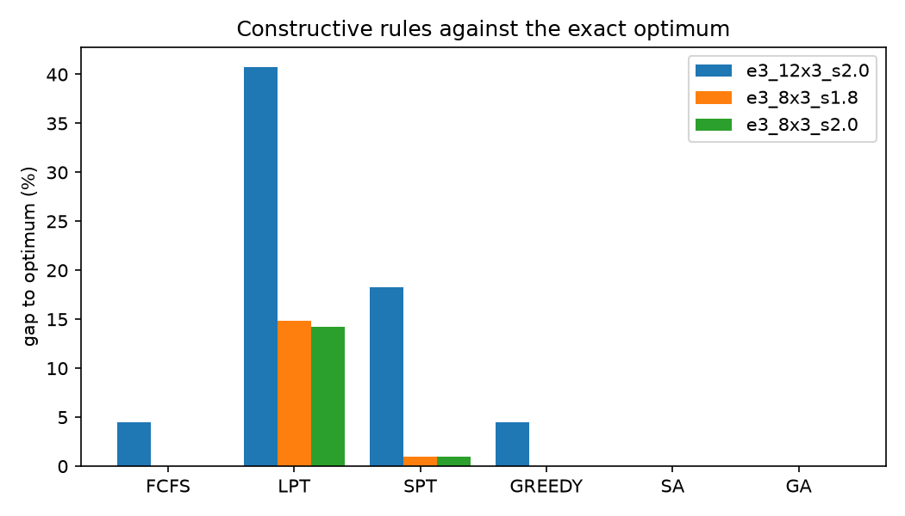
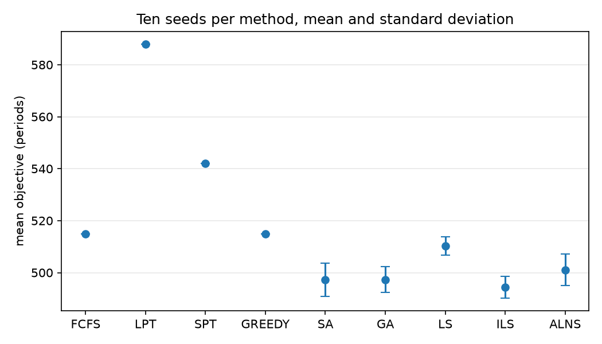

# 实验三：启发式、元启发式与求解器

> 数据来自 `experiments/run_experiments.py`，原始记录在 `experiments/data/e3_*.csv`。

## 1. 实验目的

1. 比较**构造式规则**（FCFS、LPT、SPT、GREEDY）与**元启发式**（SA、GA、LS、ILS、ALNS）相对精确最优的差距。
2. 用**多次独立运行（多 seed）**观察随机方法的波动，理解"单次运行可能把方法排名排反"。
3. 观察**求解器配置**（gap 容差、时间上限、presolve）对结果与耗时的影响。
4. 在更紧的实例上观察**构造式解码失败**：算法"解的质量"与"能否给出可行解"是两件事。

## 2. 实验环境与设置

- Python 3.12，PuLP 4.0，HiGHS 1.15.1；目标 `sum_C`，时间上限 60 s（精确模型）。
- 实例：`make_hard_instance`（带潮汐窗与岸桥上限），用 `slack` 控制 horizon 松紧。
- 参照值：精确 MILP 证明最优时用最优值；本组实验的参照全部是 `exact_proved`。
- 元启发式每组跑 10 个 seed（0–9）；构造式规则本身确定，多次运行结果相同（用于自检）。
- 所有方法共享同一个解码器（把"船的排列"变成"泊位+开始时刻"），差别只来自优先级规则或搜索。

## 3. 实验算法列表

| 名称 | 类型 | 一句话说明 |
|---|---|---|
| FCFS | 构造式规则 | 按到港时间先后服务（先到先服务） |
| LPT | 构造式规则 | 先服务作业时间最长的船 |
| SPT | 构造式规则 | 先服务作业时间最短的船 |
| GREEDY | 构造式规则 | 每次选"最早能完工"的泊位与开始时刻 |
| SA | 元启发式 | 模拟退火：随机交换船的顺序，允许暂时变差以跳出局部最优 |
| GA | 元启发式 | 遗传算法：保留一群排列，交叉、变异、选择 |
| LS | 元启发式 | 局部搜索：从初始排列出发，只接受让目标变好的交换/移动 |
| ILS | 元启发式 | 迭代局部搜索：局部搜索 + 随机"踢一脚"后重新搜索 |
| ALNS | 元启发式 | 自适应大邻域搜索：每次拆掉一部分船再重新插回，拆/插方式按效果加权 |
| 求解器配置 | 求解器 | default / tightgap(gapRel=0) / shorttime(2 s) / nopresolve / tight+short |

## 4. 实验记录

### 4.1 构造式规则与元启发式相对最优的差距

| 实例 | 精确最优 | FCFS | LPT | SPT | GREEDY | SA | GA |
|---|---|---|---|---|---|---|---|
| 8 船，slack 2.0 | 309 | 309 (0%) | 353 (14.24%) | 312 (0.97%) | 309 (0%) | 309 (0%) | 309 (0%) |
| 8 船，slack 1.8 | 309 | 309 (0%) | 355 (14.89%) | 312 (0.97%) | 309 (0%) | 309 (0%) | 309 (0%) |
| 12 船，slack 2.0 | 493 | 515 (4.46%) | 694 (40.77%) | 583 (18.26%) | 515 (4.46%) | 493 (0%) | 493 (0%) |

括号内是相对精确最优的差距（%）。原始数据：`data/e3_rules.csv`。

### 4.2 多 seed 统计（12 船，slack 1.7，精确最优 493，每个方法 10 个 seed）

| 方法 | 类型 | 均值 | 标准差 | 最好 | 最差 | 平均差距 (%) | 命中最优次数 | 平均耗时 (s) |
|---|---|---|---|---|---|---|---|---|
| FCFS | 确定性 | 515.0 | 0.00 | 515 | 515 | 4.462 | 0/10 | 0.0005 |
| LPT | 确定性 | 588.0 | 0.00 | 588 | 588 | 19.270 | 0/10 | 0.0168 |
| SPT | 确定性 | 542.0 | 0.00 | 542 | 542 | 9.939 | 0/10 | 0.0098 |
| GREEDY | 确定性 | 515.0 | 0.00 | 515 | 515 | 4.462 | 0/10 | 0.0005 |
| SA | 随机 | 497.2 | 6.42 | 493 | 507 | 0.852 | 7/10 | 3.79 |
| GA | 随机 | 497.3 | 5.02 | 493 | 507 | 0.872 | 3/10 | 3.96 |
| LS | 随机 | 510.2 | 3.49 | 507 | 515 | 3.489 | 0/10 | 0.052 |
| ILS | 随机 | 494.4 | 4.20 | 493 | 507 | 0.284 | 9/10 | 1.69 |
| ALNS | 随机 | 501.1 | 6.16 | 493 | 511 | 1.643 | 2/10 | 4.19 |

原始数据：`data/e3_multiseed.csv`。

### 4.3 求解器配置（20 船，slack 2.0，精确最优 861）

| 配置 | 目标值 | 是否证明最优 | 求解时间 (s) | gap 容差 | 时间上限 |
|---|---|---|---|---|---|
| default | 861 | 是 | 0.432 | 默认 | 无 |
| tightgap | 861 | 是 | 0.434 | 0 | 无 |
| shorttime | 861 | 是 | 0.433 | 默认 | 2 s |
| nopresolve | 861 | 是 | 0.846 | 默认 | 无 |
| tight+short | 861 | 是 | 0.435 | 0 | 2 s |

原始数据：`data/e3_configs.csv`。

### 4.4 紧实例上的可行性（12 船，slack 1.6）

| 方法 | 是否给出可行调度 | 目标值 | 备注 |
|---|---|---|---|
| FCFS | 是 | 513 | — |
| LPT | 是 | 570 | — |
| SPT | 是 | 514 | — |
| GREEDY | 是 | 578 | — |
| SA | **否** | — | 最终解码失败：4 种放置取向都无法放下全部 12 艘船 |
| GA | 是 | 496 | 本组最好 |

原始数据：`data/e3_robustness.csv`。

## 5. 实验结果与分析



**（1）规则之间的差距远大于"直觉"。** LPT 在三个实例上分别差 14.24%、14.89%、40.77%——先干最耗时的船
会让短船排到最后，总完成时间显著变大；SPT 好一些（0.97%、0.97%、18.26%），但在 12 船上仍然差近两成。
FCFS 和 GREEDY 在 8 船实例上恰好最优，在 12 船上差 4.46%。结论：**规则的表现高度依赖实例规模与松紧**，
不能用一个实例上的排名下结论。



**（2）随机方法的波动可以超过方法之间的差距。** 12 船、slack 1.7 上，SA 的标准差是 6.42，
而 SA 与 GA 的均值只差 0.1、SA 与 ILS 的均值差 2.8。也就是说，**只跑一个 seed，SA 和 GA 谁更好
完全可能由随机种子决定**；SA 的 10 次结果落在 493–507，LS 落在 507–515，SA 的最差结果已经等于
LS 的最好结果，单次运行无法稳定区分两者。
这正是"随机方法必须多 seed 报告"的原因。ILS 的均值最低（494.4）、10 次中 9 次命中，是本组最稳的方法；
LS 只做局部改进，均值 510.2、从未命中最优，说明它容易停在局部最优。

**（3）求解器配置在这个规模上只影响耗时。** 五种配置都得到 861 并证明最优；`nopresolve` 的耗时约是
默认的两倍（0.846 s 对 0.432 s），因为关闭 presolve 后模型没有经过预处理。`shorttime`（2 s 上限）
甚至没有触发限制——20 艘船在这个实例上 0.43 s 就证完了。这说明：**在这些实例上，瓶颈不是求解器配置，
而是实例本身的难度**；要让 2 s 预算真正生效，需要更大或更紧的实例。

**（4）"能否给出可行解"与"解的质量"是两件事。** 在最紧的实例（slack 1.6）上，SA 最终无法解码出
一个合法调度（返回不可行），而 GA 给出了本组最好的 496；与此同时，几个简单规则都给出了可行解。
原因是：规则自带"4 种放置取向 + 重启"的兜底，而 SA 的最终排列可能无法被解码器放下。
工程含义是：**一个搜索算法即使目标函数很好，也必须保证最后拿得出一条可行调度**，否则结果不可用。

**（5）时间与质量的权衡。** 平均耗时从 LS 的 0.05 s 到 GA 的 3.96 s，相差近 80 倍；但 GA 的均值（497.3）
并不比 ILS（494.4，1.69 s）更好。在这个规模上，ILS 用更少的时间取得了最好的平均结果。

## 6. 小结

- LPT 明显最差（最高 +40.77%），SPT 中等，FCFS/GREEDY 在松实例上已最优、在 12 船上差 4.46%。
- 随机方法的 seed 波动（SA 标准差 6.42）可以超过方法间均值差（0.1–2.8），必须多 seed 报告。
- ILS 在本组中均值最低、命中率最高；LS 从未命中最优，说明局部搜索易陷局部最优。
- 求解器配置在本规模下都证得最优；关闭 presolve 约使耗时翻倍，2 s 上限未触发。
- 紧实例上 SA 解码失败而 GA 可行：算法必须同时保证"解得好"和"拿得出可行解"。

## 7. 复现

```powershell
.venv\Scripts\python.exe experiments\run_experiments.py
```

输出：`experiments/data/e3_*.csv`，图 4–5 在 `experiments/figures/`。
