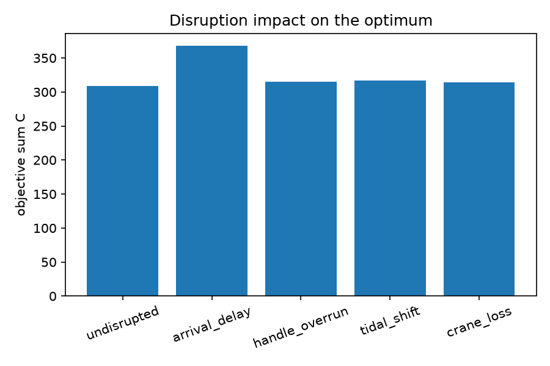
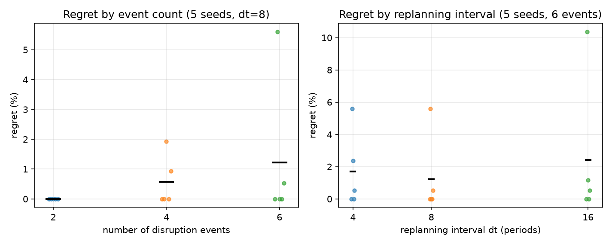

# 实验四：动态调度、滚动时域与扰动

> 数据来自 `experiments/run_experiments.py`，原始记录在 `experiments/data/e4_*.csv`。

## 1. 实验目的

1. 量化四类扰动（到港延迟、作业超时、潮汐平移、岸桥损失）对**全信息最优调度**的影响。
2. 理解**滚动时域**：决策只能看到已经发生的事件，未来按预测计划；观察"部分信息"相对"全信息"的代价（regret）。
3. 观察**重规划间隔 dt** 的影响：太久反应迟钝，太短频繁改动。
4. 检查**分层承诺**机制是否真的在起作用（regret 是否恒为 0），以及最终调度是否在"实现后的实例"上可行。

## 2. 实验环境与设置

- Python 3.12，PuLP 4.0，HiGHS 1.15.1；目标 `sum_C`。
- 基准实例：`make_hard_instance("base", 8, 3, seed=20261014, slack=2.0)`，horizon 76 个周期（38 h），
  15 个泊位周期被潮汐封住，岸桥上限 2。
- 扰动由 `make_events` 生成，幅度受界（到港延迟 ≤ 8 周期、作业超时 ≤ 4 周期、潮汐平移 ±3、岸桥损失一个窗口）。
- 对照组：扰动后的**全信息最优**（一次性求解，时间上限 5 s，要求证明最优，否则该次 regret 记为缺失）。
- 滚动时域：每 `dt` 个周期重规划一次，时间上限 5 s；承诺按"泊位可承诺、开工只能推后、已开始则固定"分层。
- 每组 5 个 seed（重规划种子），报告均值、最大值和逐 seed 结果。

## 3. 实验算法列表

| 名称 | 类型 | 一句话说明 |
|---|---|---|
| 全信息最优 | 对照（精确） | 已知全部扰动后一次性求最优，是 regret 的分母 |
| 滚动时域 | 在线方法 | 每 dt 周期用"已观测事件 + 预测"重规划，带分层承诺 |
| 到港延迟 | 扰动 | 船比预计晚到（天气/拥堵） |
| 作业超时 | 扰动 | 装卸时间变长（设备/货量） |
| 潮汐平移 | 扰动 | 封港时间窗整体前后移动 |
| 岸桥损失 | 扰动 | 某时间段可用岸桥减少（建模为时间窗） |
| regret | 指标 | `(滚动解 − 全信息最优) / 全信息最优 × 100%` |

## 4. 实验记录

### 4.1 单一扰动的代价（相对无扰动最优 309）

| 扰动 | 事件数 | 目标值 | 相对基准 (%) | 可行 |
|---|---|---|---|---|
| 无扰动 | 0 | 309 | — | 是 |
| 到港延迟（3 艘各 +5） | 3 | 368 | +19.09 | 是 |
| 作业超时（2 艘各 +3） | 2 | 315 | +1.94 | 是 |
| 潮汐平移（1 号泊位 +4） | 1 | 317 | +2.59 | 是 |
| 岸桥损失（1 台、10 周期） | 1 | 314 | +1.62 | 是 |

原始数据：`data/e4_events.csv`。

### 4.2 事件数量与 regret（dt=8，5 个 seed）

| 事件数 | 各 seed 的 regret (%) | 均值 (%) | 最大 (%) | 零 regret 比例 | 重规划次数 |
|---|---|---|---|---|---|
| 2 | 0, 0, 0, 0, 0 | 0.00 | 0.00 | 5/5 | 9 |
| 4 | 0, 0, 1.929, 0, 0.940 | 0.574 | 1.93 | 3/5 | 8–9 |
| 6 | 0, 5.602, 0, 0, 0.524 | 1.225 | 5.60 | 3/5 | 9–10 |

原始数据：`data/e4_rolling_events.csv`。

### 4.3 重规划间隔 dt 的影响（6 个事件，5 个 seed）

| dt（周期） | 各 seed 的 regret (%) | 均值 (%) | 最大 (%) | 平均重规划次数 |
|---|---|---|---|---|
| 4 | 0, 5.602, 2.360, 0, 0.524 | 1.697 | 5.60 | 15.6 |
| 8 | 0, 5.602, 0, 0, 0.524 | 1.225 | 5.60 | 9.4 |
| 16 | 0, 10.364, 1.180, 0, 0.524 | 2.414 | 10.36 | 5.0 |

原始数据：`data/e4_rolling_dt.csv`。

### 4.4 可行性与承诺

- 15 次"事件数"实验和 15 次"dt"实验，滚动解**全部**通过独立检查器（可行），没有出现不可行的滚动调度。
- 全信息最优在全部运行中都被证明为最优（`perfect_proved=True`），因此 regret 的分母可信。
- 2 个事件时 5/5 次 regret 为 0；4/6 个事件时各只有 3/5 次为 0。regret **不是恒等于 0**，说明承诺机制确实在部分种子上绑定了决策。

## 5. 实验结果与分析



**（1）到港延迟的影响远大于其他扰动。** 到港延迟 +19.09%，而作业超时、潮汐平移、岸桥损失分别只有
+1.94%、+2.59%、+1.62%。原因是到港延迟直接改变了"最早能开工"的时刻，整条泊位序列都要后移；
其余三类扰动的幅度受界（超时最多 4 个周期、潮汐 ±3、岸桥损失一个窗口），在 slack=2.0 的实例上
还有缓冲。这也说明：如果港口只能改善一件事，减少到港不确定性（或更早获知 ETA）收益最大。



**（2）regret 随事件数增加，但多数运行仍能恢复到全信息最优。** 2 个事件时 5 个 seed 全部 0；
4 个事件均值 0.574%、最大 1.93%；6 个事件均值 1.225%、最大 5.60%。也就是说，在 8 船、slack=2.0 的
实例上，即使只看到部分事件，滚动规划也常常能补回最优调度。这说明实例偏"容易"：
要观察更明显的"信息代价"，需要更大的船队或更紧的 slack。但零 regret 并非全部——6 个事件时有 2/5
的运行非零，这恰好说明承诺机制在起作用：如果每个决策点都从零重优化，最后一个决策点已经看到全部
事件，regret 会恒等于 0（项目里专门有一个检查会警告这种情况）。

**（3）dt 不是越小越好。** dt=4 平均重规划 15.6 次，但均值（1.697%）反而高于 dt=8（1.225%）；
dt=16 只重规划 5 次，均值最高（2.414%），最差 seed 达到 10.36%。可以这样理解：dt 太小会频繁改动
尚未发生的计划，而承诺一旦下达又不易收回，反而制造了额外约束；dt 太大则对扰动反应迟钝。
本实验的样本量（5 个 seed）不足以断言"dt=8 最优"是普遍规律，但**"重规划频率与解质量不是单调关系"**
这一结论是清楚的。

**（4）可行性是硬要求，滚动解全部通过独立检查。** 30 次滚动运行全部在"实现后的实例"上重建并通过
`check_solution`，没有一次把不可行调度报成可行。这是动态实验里最容易被忽略的一点：滚动规划在
预测实例上可行，不等于在真实实例上可行；本项目用"最后按实现重建 + 释放无法维持的承诺"来保证这一点。

## 6. 小结

- 四类扰动中到港延迟最贵（+19.09%），其余三类在 2% 左右，幅度受界与 slack 缓冲是原因。
- regret 随事件数增加（均值 0 → 0.574% → 1.225%），但 8 船实例上多数运行仍能恢复到全信息最优。
- regret 不是恒为 0，说明分层承诺确实在绑定决策；若恒为 0 反而说明机制没生效。
- dt 与解质量非单调：dt=8 在本组最好，dt=16 最差（最大 10.36%），dt=4 增加了重规划次数却没有更好。
- 30 次滚动调度全部可行；regret 的分母全部是"已证明最优"的全信息解。

## 7. 复现

```powershell
.venv\Scripts\python.exe experiments\run_experiments.py
```

输出：`experiments/data/e4_*.csv`，图 6–7 在 `experiments/figures/`。
